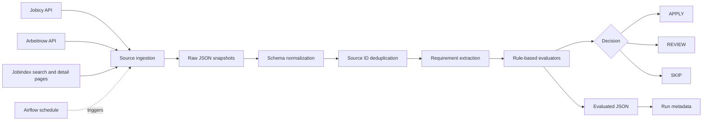

# Job Market Intelligence Pipeline

A personal job radar for data engineering and analytics engineering roles. It
collects postings, normalizes the source schemas, removes source-ID duplicates,
extracts explicit requirements, and assigns `APPLY`, `REVIEW`, or `SKIP` with
inspectable reasons.

## Sources

- Jobicy remote-job API
- Arbeitnow job-board API
- Jobindex search and detail pages

Jobicy and Arbeitnow are auxiliary sources. Jobindex is the main Denmark source.
The pipeline deliberately fails when Jobindex search is unavailable instead of
silently reporting an incomplete run as successful.

## Pipeline

```text
source ingestion
  -> raw JSON snapshots
  -> source normalization
  -> source-ID deduplication
  -> role/location/language/authorization/technical evaluation
  -> evaluated JSON + run metadata
```


Outputs are written under `data/` and are intentionally excluded from Git.

## Local setup

Python 3.12 and [uv](https://docs.astral.sh/uv/) are required.

```bash
uv sync --frozen
uv run python -m job_market_intelligence
```

The installed command is equivalent:

```bash
uv run job-market-intelligence
```

Run the regression suite without external API calls:

```bash
uv run python -m unittest discover -s tests -v
```

## Airflow and Docker

The DAG runs at 09:00 Europe/Copenhagen time on weekdays. Build and start the
standalone Airflow image with:

```bash
docker build -t job-radar .
docker run --rm -p 8080:8080 \
  -v "$PWD/data:/app/data" \
  job-radar
```

The data volume is required. Without it, raw files, evaluated results, and run
metadata disappear when the container is removed.

## Known limitations

- Candidate skills and target geography are still hard-coded.
- Deduplication is exact by source ID; the same vacancy syndicated by two
  providers can remain twice.
- External Jobindex application pages can block scraping, leaving a short or
  empty description that must remain `REVIEW`.
- Requirement extraction is deterministic and conservative, not a general NLP
  model. New ATS heading variants need regression fixtures before parser changes.
- The pipeline creates full snapshots; it does not yet track new, changed,
  expired, or already-reviewed vacancies across runs.


## Example output

A synthetic evaluated-job example is available in
[`examples/sample_evaluated_jobs.json`](examples/sample_evaluated_jobs.json).

The example contains no real employer, vacancy, applicant, or job-description
data. Runtime data under `data/` is excluded from Git.